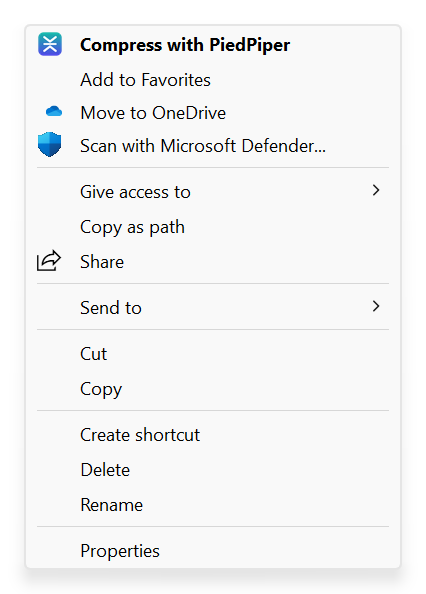
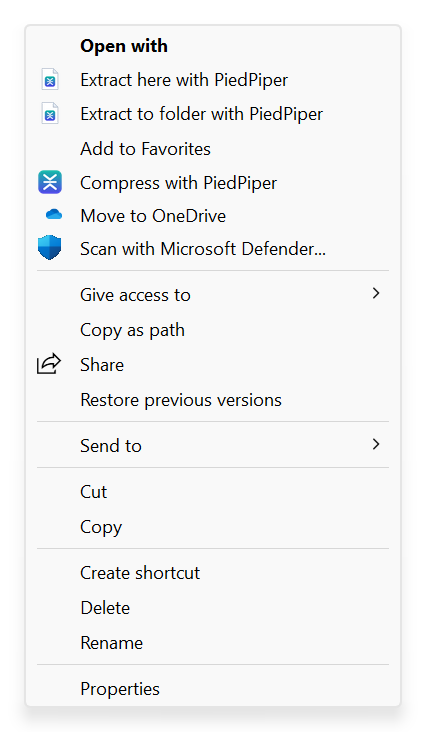
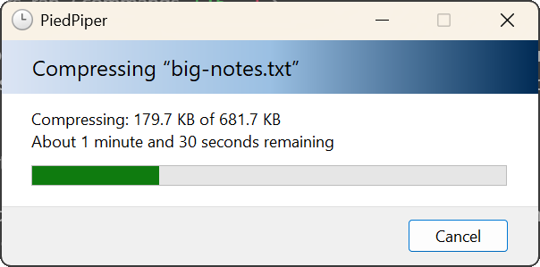
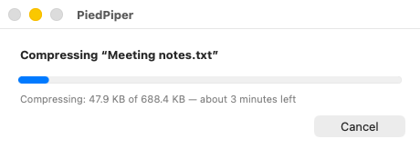
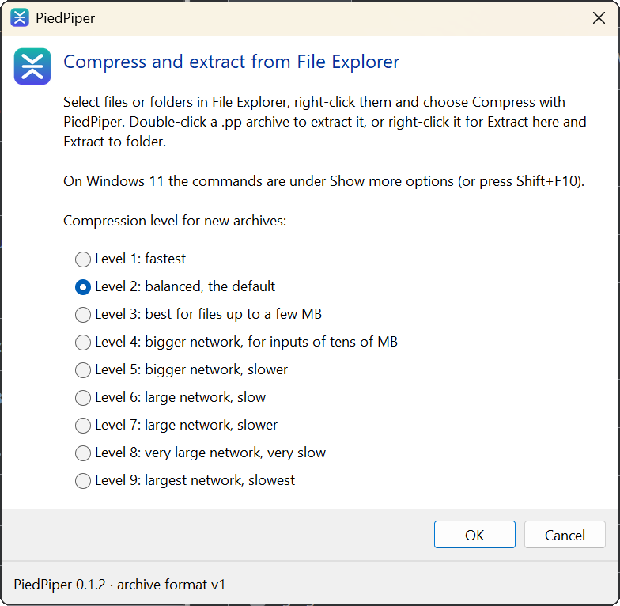
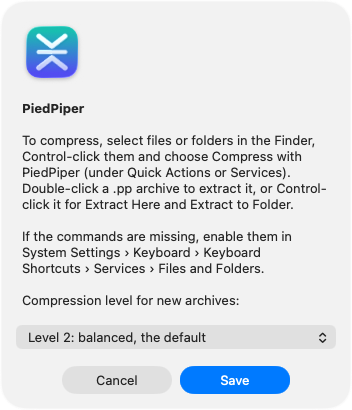

# PiedPiper

**Neural lossless compression for every platform**, using the
[TufaZip](https://tufalabs.ai/research/tufazip/) method by
[Tommy He](https://x.com/tommyhe41) at [Tufa Labs](https://tufalabs.ai/). A Transformer
learns your data *while* it compresses it and drives an arithmetic coder. The decoder
re-learns the same weights as it decodes, so the model is never stored.

PiedPiper re-engineers the method to run on ordinary CPUs and to be **bit-exact
everywhere**. A file compressed on a Windows laptop decompresses on a Linux server, an
Android phone, in Python, or in a browser.

## Download

| Your computer | Download |
|---|---|
| **Windows 10 or 11** | **[PiedPiper-Windows-x64.msi](https://github.com/gnubyte/piedpiper/releases/latest/download/PiedPiper-Windows-x64.msi)** |
| **Mac** (macOS 11 or later, Apple Silicon or Intel) | **[PiedPiper-macOS.dmg](https://github.com/gnubyte/piedpiper/releases/latest/download/PiedPiper-macOS.dmg)** |

Install it, then right-click any files or folders and choose **Compress with PiedPiper**:
everything you selected goes into one `.pp` archive. Double-click a `.pp` archive to extract
it, or right-click it for **Extract here** and **Extract to folder**. On Windows 11 the
commands are under **Show more options**; on a Mac, Control-click and look under **Quick
Actions** or **Services**. The builds aren't code-signed yet, so Windows SmartScreen (**More
info → Run anyway**) or macOS (**System Settings → Privacy & Security → Open Anyway**) asks
once on first launch.

### Screenshots

| Right-click any files or folders | Right-click a `.pp` archive |
|:---:|:---:|
|  |  |

| Windows: progress, time left and Cancel | Mac: progress, time left and Cancel |
|:---:|:---:|
|  |  |

| Windows: Start menu → PiedPiper | Mac: opening the app |
|:---:|:---:|
|  |  |

The menus are Windows 11's full right-click menu (**Show more options**); Windows 10 shows
them directly.

The [releases page](https://github.com/gnubyte/piedpiper/releases/latest) also has the
command-line tool, the C library, and the Python, npm and Android packages.

| Platform | Package | Where |
|---|---|---|
| Windows, Linux, macOS (x86-64 & ARM64) | `piedpiper` command-line tool | [`crates/cli`](crates/cli) |
| Windows 10/11, macOS 11+ | right-click Compress / Extract app: MSI installer, DMG | [`apps/desktop`](apps/desktop) |
| Android (arm64-v8a, armeabi-v7a, x86_64) | AAR library + demo app | [`bindings/android`](bindings/android) |
| JavaScript (browsers, Node, Deno, Bun) | `piedpiper` npm package (WebAssembly, ~5.9 MB incl. five built-in priors) | [`bindings/js`](bindings/js) |
| Python 3.9+ | `piedpiper` wheel (PyO3, abi3) | [`bindings/python`](bindings/python) |
| C / C++ / Swift / Go / C# | `libpiedpiper` + `piedpiper.h` | [`crates/capi`](crates/capi) |
| Rust | `piedpiper` crate | [`crates/core`](crates/core) |

## How it works

```
             ┌──────────── same deterministic loop on both sides ────────────┐
 tokens ──►  │  Transformer ──► p(next) ──► range coder ──► bits             │
             │       ▲                          │                            │
             │       └──── Adam step on what was just coded ◄──┘             │
             └───────────────────────────────────────────────────────────────┘
```

* **Model:** a decoder-only Transformer with TufaZip v2's block design: Peri-LN (RMSNorm
  before *and* after each sub-layer), per-head QK-norm, RoPE, SwiGLU, untied embeddings, no
  biases. Levels 1–9 scale it from 0.14M to ~40M parameters.
* **Online learning:** the input is split into parallel streams. After each short segment,
  encoder and decoder take the identical Adam step (β1 = 0, as in TufaZip and NNCP).
* **Tokenizers:** raw bytes, or a word-aware BPE vocabulary learned from the file and
  stored in its header (TufaZip used a 4K word vocabulary).
* **Priors:** like TufaZip v2, compression starts from an offline-trained prior instead of
  random weights. Three text priors are built in and used automatically for text at levels
  1–3. You can train your own with `piedpiper train`.
* **Determinism:** only IEEE-754 basic operations, a fixed summation order in every
  kernel, home-made `exp`/`sin`/`cos` instead of libm, and pinned FPU modes. That keeps
  results bit-identical across CPUs, SIMD widths (SSE2/AVX2/NEON/WASM-SIMD), thread counts
  and languages. See [docs/DESIGN.md](docs/DESIGN.md).

## Quick start

**CLI** (gzip/xz-style):

```bash
piedpiper -3 big.log                  # -> big.log.pp   (levels 1..9, default 2)
piedpiper -d big.log.pp               # -> big.log
piedpiper info big.log.pp             # model, tokenizer, sizes
piedpiper bench -3 file               # compress + decompress + verify, with speeds
piedpiper train -o code.ppp corpus/*  # train a prior; use it with --prior code.ppp
```

**Windows and macOS desktop** (MSI / DMG from the releases): select files or folders in File
Explorer or the Finder, right-click, **Compress with PiedPiper**; double-click a `.pp` archive to
extract it. Several items become one `Archive.tar.pp`. See [apps/desktop](apps/desktop).

**Python:**

```python
import piedpiper
packed = piedpiper.compress(data, level=3, progress=lambda d, t: print(d / t))
assert piedpiper.decompress(packed) == data
```

**JavaScript:**

```js
import { init, compress, decompress, createWorker } from 'piedpiper';
await init();
const packed = compress(bytes, { level: 3 });
const pp = createWorker();                         // off the main thread in browsers
const plain = await pp.decompress(packed);
```

**Android (Kotlin):**

```kotlin
val packed = PiedPiper.compress(bytes, PiedPiper.Options(level = 3)) { done, total -> true }
val plain = PiedPiper.decompress(packed)
```

**C:**

```c
pp_options opt; pp_options_default(&opt);
pp_buffer out = {0};
pp_compress(data, len, &opt, NULL, NULL, NULL, &out);  /* ... */  pp_buffer_free(&out);
```

## Levels

| level | network | params | built-in prior | best for |
|---|---|---|---|---|
| 1 | 2 layers × 64 | 0.14M | `text-s` | quick runs, phones |
| **2** (default) | 3 layers × 96 | 0.38M | `text-m` | everyday documents, code, logs; Office files and archives |
| 3 | 4 layers × 128 | 0.87M | `text-l` | best ratio on text up to a few MB (3–7% below level 2, about 3× slower; containers gain only 1–2%) |
| 4–9 | 5×160 … 12×512 | 1.6M–40M | none | large inputs (tens of MB and up), where online learning dominates |

Built-in priors apply to text-like input; binary data always trains from scratch.
`--no-prior` (CLI), `builtin_prior=False` (Python) or `builtinPrior: false` (JS) turns them
off. Text of 1 MB or more without a prior gets a word-level BPE vocabulary learned from the
file itself.

## Custom priors

If you compress many similar files, such as logs from one service, records of one schema,
or code in one language, a prior trained on samples of that data beats the general
built-in ones:

```bash
piedpiper train -o logs.ppp -2 --epochs 2 samples/*.log    # same shape as level 2
piedpiper -2 --prior logs.ppp today.log                     # compress
piedpiper -d --prior logs.ppp today.log.pp                  # the prior is needed again
```

Streams record the prior's id, so decompressing with the wrong prior fails cleanly instead
of producing garbage. Every API accepts priors (`prior=` in Python, `prior:` in JS,
`CompressOptions.prior` on Android, `pp_prior_load` in C).

## What to expect

Neural compression trades speed for ratio. PiedPiper runs at roughly **3–50 KB/s per
core** depending on level and input size, against hundreds of MB/s for zstd: 1 MB of text
takes about 100 s at level 2 on one core (decompression is about as fast), or 25 s at level
1 with eight threads. Small files run slower per byte. On text it
compresses well past xz from the first kilobyte, thanks to the priors, the online learning
keeps adapting to your file as it goes, and a match model catches repeats that lie beyond
the network's attention window.

Bits per byte on held-out files (lower is better; every PiedPiper number is a full
compress + decompress + compare). The prose, Java, C, XML and HTML files come from the Rust
books, the Android SDK sources and resources, the NDK headers and the Rust standard library
docs, all excluded from prior training; the log, CSV and JSON files are synthetic.

| file | size | gzip -9 | bzip2 -9 | brotli -11 | xz -9e | PiedPiper -1 | -2 | -3 |
|---|---:|---:|---:|---:|---:|---:|---:|---:|
| English prose | 200 KB | 2.207 | 1.924 | 1.832 | 1.948 | 1.588 | 1.407 | **1.346** |
| Java source | 200 KB | 1.434 | 1.163 | 1.121 | 1.200 | 0.898 | 0.766 | **0.757** |
| C source | 200 KB | 1.670 | 1.468 | 1.323 | 1.396 | 1.163 | 1.016 | **0.982** |
| XML | 200 KB | 1.153 | 1.059 | 0.891 | 0.913 | 0.707 | 0.639 | **0.625** |
| HTML | 200 KB | 1.215 | 0.989 | 0.909 | 0.957 | 0.726 | 0.607 | **0.581** |
| server log (synthetic) | 403 KB | 1.571 | 1.129 | 1.255 | 1.289 | 0.867 | 0.853 | **0.851** |
| CSV orders (synthetic) | 407 KB | 1.666 | 1.089 | 1.365 | 1.339 | 0.846 | 0.818 | **0.795** |
| JSON records (synthetic) | 424 KB | 0.731 | 0.406 | 0.593 | 0.573 | 0.323 | 0.315 | **0.312** |

Container formats, compressed to this share of their original size at the default level:

| file | size | xz -9e | PiedPiper -2 | size vs xz |
|---|---:|---:|---:|---:|
| Excel workbook (.xlsx) | 0.16 MB | 99.4% | **37.5%** | -62.3% |
| Word document with 2 photos (.docx) | 1.05 MB | 100.0% | **71.0%** | -29.0% |
| PDF with a photo | 1.03 MB | 97.4% | **70.0%** | -28.1% |
| PDF manual (text + figures) | 0.27 MB | 82.2% | **72.1%** | -12.3% |
| Java archive (.jar) | 1.10 MB | 90.5% | **48.3%** | -46.7% |
| Android library (.aar, JAR inside) | 0.22 MB | 99.7% | **48.4%** | -51.5% |
| ZIP of 3 Office documents | 1.22 MB | 100.0% | **66.6%** | -33.4% |
| APK-style ZIP with a stored photo | 1.03 MB | 97.4% | **70.0%** | -28.1% |
| PNG image | 0.76 MB | 94.4% | **87.7%** | -7.2% |
| gzip'd text (.gz) | 0.29 MB | 100.0% | **65.6%** | -34.4% |
| tarball: photo, 2 Office files, Java (.tar) | 0.26 MB | 78.4% | **37.9%** | -51.6% |
| the same as .tar.gz | 0.20 MB | 100.0% | **48.0%** | -52.0% |
| PDF with a raw (FlateDecode) photo | 0.11 MB | 100.1% | **51.3%** | -48.8% |
| Windows DLL (x86-64) | 0.66 MB | 26.7% | **24.8%** | -7.1% |
| Windows EXE (x86-64) | 0.34 MB | 40.5% | **35.6%** | -12.0% |
| Android library (ARM64 .so) | 0.65 MB | 38.6% | **37.0%** | -4.1% |

The JPEG photos inside the DOCX, PDF and APK go to the JPEG recoder; the AAR and the ZIP of
Office files are expanded two levels deep.

**Office documents, archives, PDFs and PNGs** (format mode 4) are already
DEFLATE-compressed, which hides their content from any model. PiedPiper inflates each
stream, compresses what is inside, and on decompression recreates the original compressed
bytes exactly (with [preflate-rs](https://github.com/microsoft/preflate-rs)). Files found
inside get their own treatment: photos in DOCX, PPTX, EPUB, APK and PDF files go to the
JPEG recoder, raw images in PDFs get the image filter, and nested containers (a ZIP of
Office files, an AAR's classes.jar) are expanded again. Tar archives (`.tar`, `.tar.gz`)
hand their members out the same way: a tarball of photos and Office files came out at half
the size xz reaches. `--no-deflate` turns this off.

**Executables** (Windows PE, Linux ELF, macOS Mach-O) get a branch filter first, as in xz
and 7-Zip, so repeated calls to one function look alike. They remain the hardest file type
for a model that learns from scratch: 4–12% smaller than `xz -9e`, and level with xz using
its own branch filter (from 0.4% larger on ARM64 to 8% smaller on x86-64). `--no-filter`
turns it off.

**Already-compressed files** (xz, zstd, 7z, rar, bzip2, MP3, AAC, Ogg, FLAC, WebP, WOFF2,
HEIC/AVIF) are recognised from their signature plus a quick randomness check and stored as
they are, instead of spending a long time in the neural model to save next to nothing.

**JPEG files** are recompressed losslessly with Lepton instead (format mode 3): about
**22% smaller** for typical photos, bit-exact on decompression, at several MB/s. Byte-level
models, the Transformer included, save only 1–5% on JPEGs because their data is already
entropy-coded. See [docs/DESIGN.md](docs/DESIGN.md#jpeg-recompression).

**Images**: raw pixels (BMP, PPM/PGM/PAM, TGA) and the pixels inside PNG files get a
reversible colour + 2-D prediction filter before the model sees them, like WebP lossless.
On test photos the model then needs 21–31% fewer bytes than for the raw pixels, on par
with or better than WebP lossless, and PNG pixels 11–34% fewer than the PNG's own scanlines. See [docs/DESIGN.md](docs/DESIGN.md#image-filter).

**Video files** (MP4/MOV/MKV/WebM and MPEG transport streams with H.264 or HEVC, MKV/WebM with VP9 or VP8, MKV with MPEG-2) get the same treatment (format mode 2).
These codecs already removed nearly all of the redundancy, so byte-level compressors get
almost nothing: xz and the Transformer measure about 8.0 bits per byte on real clips.
PiedPiper instead parses each slice (or VP8/VP9 partition) down to its entropy coder's decisions, codes them with a stronger
context-mixing model, and rebuilds the original bitstream bit for bit on decompression:

| file | content | size | xz -9e | PiedPiper |
|---|---|---:|---:|---:|
| game trailer, 1080p | rendered footage | 18.6 MB | 0.2% | **7.0% smaller** |
| IDE walkthroughs (23 clips) | screen recordings | 11.9 MB | — | **20.4% smaller** (8.3–52%) |
| IDE screencast, 720p | screen recording | 1.35 MB | 2.1% | **14.2% smaller** |
| setup animation, 4.5K | motion graphics with padding | 593 KB | 48.6% | **58.2% smaller** |
| phone video, 1080p (3 clips) | camera footage, HEVC | 20.8 MB | 0.2% | **6.4% smaller** |
| phone video, 4K (2 clips) | camera footage, HEVC | 127 MB | 0.1% | **8.1% smaller** (6.5–10.1%) |
| game trailer, 1080p, GPU-encoded | rendered footage, HEVC | 34.5 MB | 15.8% | **24.4% smaller** |
| display samples, 1080p (2 clips) | camera-like footage, VP9 8-bit and 10-bit HDR | 3.58 MB | 0.0% | **5.6% smaller** |
| app UI animations (24 clips) | motion graphics, VP9 with Opus audio | 10.3 MB | 0.9% | **8.2% smaller** (video 8.5–25%) |
| HDR calibration clip, 4K | test patterns, VP9 10-bit | 898 KB | 73.6% | **75.7% smaller** |
| older WebM clips (4 files, 406x720 to 1280x720) | mixed footage, VP8 | 9.04 MB | 0.0% | **15.7% smaller** (12.1–23.3%) |
| DVD rip, 720x480 interlaced | film, MPEG-2 in MKV with 4 AC3 tracks | 1.52 GB | 1.7%¹ | **18.7% smaller** (video 19.6%, AC-3 audio 13.7%) |
| video clips, 1080p (18 files, one 720p) | H.264 Baseline (CAVLC) | 1.83 GB | 2.3%² | **17.3% smaller** (14.6–31.1%) |
| recordings in fragmented MP4 (3 files) | H.264 High (CABAC), `moof`/`trun` sample tables | 413 MB | 0.1% | **6.7% smaller** (6.2–34.4%) |
| game capture | H.264 High (CABAC) in an MPEG transport stream | 1.05 GB | 2.6% | **11.1% smaller** (slices 8.1%) |
| phone video remuxed to `.ts` (2 recordings) | camera footage, HEVC | 883 MB | 0.4% | **9.7% smaller** (7.8% and 11.7%) |
| remuxed to `.m2ts` (192-byte packets): one of them, and a clip | HEVC; H.264 Baseline (CAVLC) | 513 MB | — | **13.6% and 29.8% smaller** |

The HEVC phone clips come from a Pixel phone. The `.ts` and `.m2ts` files other than the game
capture were remuxed from MP4 files with `crates/media/examples/tsmux.rs` (video only, evenly
spaced BDAV time stamps), so their slices are the original encoders'; the slices shrink about
as much as in the MP4 files, and the packet and PES headers around them almost vanish.
The HEVC trailer was re-encoded with a GPU
encoder that pads to a constant bitrate with filler data (16% of the file), which xz removes
too; its HEVC slice data alone shrinks 10.9%. On 102 HEVC conformance test streams every slice
recodes except the few that use PCM blocks. ¹xz -6 on the first 100 MB. ²xz -9e on four of the files (90 MB). The VP9 clips are Windows' display-settings
samples and a game client's UI animations; the calibration clip repeats 887 of its 1,046
frames byte for byte, and repeated frames are stored as references to the earlier copy.

Every clip decompresses byte-identical, and the encoder checks that before it uses mode 2.
The recoder runs at about 0.3–0.5 MB/s per core to compress and 0.2–0.4 MB/s to decompress
(measured on a busy 8-core Ryzen 7 5800). Files larger than about 3 MB are split into
segments that are coded in parallel on up to 8 threads; the thread count never changes the
output. HEVC recodes at about the same speed. It handles H.264 with CABAC or CAVLC (Baseline,
Main and High profiles: progressive, 4:2:0, 8-bit) and HEVC (Main, Main 10 and Main Still Picture: 4:2:0 or
monochrome, 8–12 bit, with tiles or wavefronts and dependent slices), which covers most phone,
camera and screen-recorder files, in MP4/MOV (plain or fragmented) or Matroska/WebM. VP9 is handled in Matroska/WebM
for profiles 0 and 2 (4:2:0, 8–12 bit) when the stream keeps its probabilities per frame
(frame-parallel or error-resilient, as all 31 VP9 files found on the test machine do), and
VP8 in Matroska/WebM completely, and MPEG-2 in Matroska (DVD rips) together with their
AC-3 audio tracks, whose frames are recoded the same way: every bit coded in context, the
mantissa sizes taken from AC-3's own bit allocation, and the CRCs recomputed instead of stored
(on the rip above the audio shrinks 13.7%, where the video recoder alone left it at 1.7%).
VP8 and MPEG-2 gain the most: VP8's entropy coding has the simplest contexts of
these codecs, and MPEG-2 has no adaptive entropy coder at all, only fixed variable-length
codes, which the model replaces bit by bit. Baseline H.264 (CAVLC) is coded the same way and
gains at least as much (17.3% on the 18 files above); it recodes at 2–4 MB/s on 6 threads.
H.264 and HEVC in MPEG transport streams (`.ts`, the 192-byte packets of `.m2ts` and `.mts`, and
some `.mpg` captures) are split into the elementary stream, which is recoded like an MP4 track,
and the packet and PES headers around it.

Other compressed video (AV1 in any container, VP8/VP9 in MP4, VP9 with backward probability adaptation, MPEG-1/2 in MPEG-PS/TS or AVI, FLV, HEVC it cannot parse) is
recognised from its container and a quick randomness check and stored as is in
milliseconds, instead of spending hours in the neural model to save next to nothing.
`--no-video` (CLI) or `CompressOptions::media = false` (Rust) turns both off. See
[docs/DESIGN.md](docs/DESIGN.md#video-h264-and-hevc-recompression-format-mode-2).

**Audio files** (WAV with 16-bit samples, mono or stereo) get a dedicated lossless-audio
path (format mode 5). On raw samples a byte-level model loses to FLAC: audio's redundancy is
linear prediction, which a network learning from a single file does not discover.
PiedPiper turns stereo into mid and side, predicts each sample with a cascade of adaptive
filters (normalised LMS, as in Monkey's Audio and OptimFROG), switches to a predictor fitted
to the block (as in FLAC) where that does better, and codes the prediction errors with a
small context-mixing model:

| file | length | FLAC -8 | PiedPiper `--no-audio` | PiedPiper |
|---|---:|---:|---:|---:|
| speech (synthesised), 22 kHz mono | 31 s | 46.2% | 53.0% | **41.2%** |
| music (decoded MP3), 44.1 kHz stereo | 8 s | 23.9% | 34.6% | **21.1%** |
| ringtone, 22 kHz stereo | 13 s | 49.0% | 53.0% | **46.3%** |

Sizes are % of the WAV file at the default level (FLAC -8 estimated): 6–12% below FLAC's
strongest setting. On the 77 clips the filters were tuned on (system sounds, speech, music
excerpts) it came out 20% below FLAC, and on 87 other clips (mostly short synthesised game
sound effects) 7% below, smaller than FLAC on every file. It runs at about 5 MB/s
each way on one core (a 3-minute song in 7 seconds); `-1` is twice as fast, `-4` to `-9`
slightly smaller and slower. Text-like ratios are out of reach for any lossless coder,
because the low bits of every recording are noise. `--no-audio` (CLI) or
`CompressOptions::audio = false` (Rust) turns it off; with `--prior` the network codes the
prediction errors instead, and `piedpiper train` on WAV files trains such a prior. See
[docs/DESIGN.md](docs/DESIGN.md#audio-pcm-prediction-format-mode-5).


## Cross-platform guarantee

[`testdata/golden`](testdata/golden) contains streams made by the Windows x86-64 build.
Every port must decode them and reproduce them byte for byte on re-encoding. CI checks
this on Linux (x86-64, ARM64), macOS (Intel, Apple Silicon), Windows (x86-64, ARM64),
WebAssembly, the Python wheel, the C ABI and Android:

```bash
python scripts/check_golden.py            # CLI
python crates/capi/tests/capi_golden.py   # C ABI
node bindings/js/test/golden.mjs          # WebAssembly
python -m unittest discover -s bindings/python/tests
```

## Building

```bash
cargo build --release                 # CLI -> target/release/piedpiper
cargo test -p piedpiper --release     # core tests (incl. gradient check)
cargo test -p piedpiper-media --release   # video recoders (synthetic H.264/HEVC/VP9/VP8 streams)
python bindings/js/build.py           # WebAssembly -> bindings/js/src/piedpiper.wasm
cd bindings/python && maturin build --release
bash bindings/android/build-native.sh && (cd bindings/android && ./gradlew assembleRelease)
pwsh apps/desktop/packaging/windows/build-msi.ps1     # Windows installer (needs WiX 5) -> dist/*.msi
bash apps/desktop/packaging/macos/build-dmg.sh        # macOS app -> dist/*.dmg
```

## Credits

The method PiedPiper implements is **TufaZip**, created by
**[Tommy He](https://x.com/tommyhe41)** at **[Tufa Labs](https://tufalabs.ai/)** and
described in [tufazip: Learning to Compress a Billion Bytes of
Wikipedia](https://tufalabs.ai/research/tufazip/) (October 2026). PiedPiper follows its
design: a Transformer that learns the data while it codes it, TufaZip v2's block layout, a
word-level vocabulary learned from the input, and offline-trained priors. Credit and thanks
to Tommy He and Tufa Labs.

## Relation to TufaZip

PiedPiper is an independent implementation of the published method; it is not affiliated
with Tufa Labs. The
original is a benchmark entry: 163M parameters, two B200 GPUs, about a week per gigabyte,
and decodable only on the identical CUDA software stack. PiedPiper uses much smaller
networks to stay practical on phones and in browsers, and it cannot read TufaZip's own
files. [docs/DESIGN.md](docs/DESIGN.md) lists the differences, and
[docs/FORMAT.md](docs/FORMAT.md) specifies the file formats.

## License

MIT. JPEG and deflate support include Apache-2.0 code (Lepton, preflate-rs): see
[THIRD_PARTY_NOTICES.md](THIRD_PARTY_NOTICES.md). preflate-rs's LGPL-3.0 dependency
`cabac` is replaced by PiedPiper's own MIT implementation (`crates/cabac-shim`), so no
LGPL code ends up in any package.
