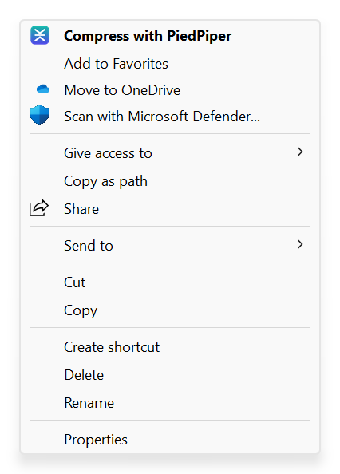
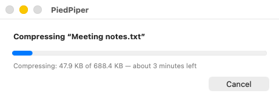

# PiedPiper for Windows and macOS

Right-click compression for File Explorer and the Finder, with PiedPiper as the engine.

| | Windows (MSI) | macOS (DMG) |
|---|---|---|
| Compress the selection | right-click → **Compress with PiedPiper** | Control-click → Quick Actions / Services → **Compress with PiedPiper** |
| Extract next to the archive | double-click a `.pp` file, or **Extract here with PiedPiper** | double-click, or **Extract Here with PiedPiper** |
| Extract into a new folder | **Extract to folder with PiedPiper** | **Extract to Folder with PiedPiper** |
| Settings (compression level) | Start menu → PiedPiper | open PiedPiper.app |

Every command works on any number of selected items. A progress window shows how far along it
is and how long is left, and **Cancel** stops it without leaving partial files behind.

 

More screenshots are in the main [README](../../README.md#screenshots). To retake them:
`cargo run --example menu_screenshot -- OUT.bmp FILE...` for File Explorer's menu (after
`piedpiper-archiver register`), and the hand-run **Screenshots** workflow for the Mac windows.

## What it makes

* **One file** becomes `name.ext.pp`, a plain PiedPiper stream, the same as `piedpiper name.ext`.
* **Several items, or a folder,** become `Name.tar.pp` (`Archive.tar.pp` for a mixed selection):
  a tarball in one PiedPiper stream. The model learns across all files, and the core hands
  photos, documents and archives inside the tarball to their own recoders. File times,
  permissions, empty folders and symbolic links are kept; Finder `.DS_Store` files are left out.

Both are ordinary PiedPiper streams, so the command-line tool and every SDK read them:
`piedpiper -d Photos.tar.pp && tar xf Photos.tar`.

Extracting never overwrites anything. **Extract** (double-click) behaves like the Finder's
Archive Utility: an archive with one item at the top puts that item next to the archive, one
with several puts them in a new folder named after it. **Extract here** always unpacks next to
the archive and **Extract to folder** always into a new folder. Any name that is already taken
gets a number: `Photos (2)` on Windows, `Photos 2` on macOS. Entries that would land outside the
destination (`../x`, absolute paths) are skipped and reported, and names Windows cannot store
(`a:b.txt`, `con`) are adjusted.

PiedPiper keeps an archive in memory while it works and learns from the data as it goes. That
makes it slow on text (tens of KB/s per core, see the main [README](../../README.md#what-to-expect))
and much faster on photos and video. Selections over 2 GB ask for confirmation first.

## How it plugs into the OS

**Windows.** The verbs are "DropTarget" verbs. File Explorer starts `piedpiper-archiver.exe
--com ACTION` as a COM local server and drops the whole selection on it, so 500 selected files
start one process, not 500. `MultiSelectModel = Player` keeps the verbs visible above
Explorer's 15-item limit. The double-click on `.pp` files is a plain command line. On Windows 11
the commands are under **Show more options** (Shift+F10). The new top-level menu only lists
apps that have a signed MSIX package identity.

The registry values are in [`src/explorer.rs`](src/explorer.rs); the MSI
([`packaging/windows/PiedPiper.wxs`](packaging/windows/PiedPiper.wxs)) writes the same values
under `HKLM\Software\Classes`, and a unit test fails if the two drift apart. Without the
installer, `piedpiper-archiver register` writes them for the current user (`--machine` for all
users, as administrator) and `unregister` removes them.

**macOS.** The three commands are `NSServices` in [`Info.plist`](packaging/macos/Info.plist):
macOS starts the app when one is chosen and passes the selection on a pasteboard. The app also
declares the `com.piedpiper.archive` type for `.pp` files, so double-clicking one extracts it.
macOS picks up the commands once the app is in Applications and has been opened once. If they
are missing, enable them under System Settings → Keyboard → Keyboard Shortcuts → Services →
Files and Folders.

Unsigned builds warn on first launch: on Windows, SmartScreen asks first (More info → Run
anyway); on macOS, open the app once from System Settings → Privacy & Security → Open Anyway.
Signed and notarized builds need the secrets listed below.

## Building

```bash
cargo test --release                       # engine + Windows registry/MSI consistency tests
cargo build --release                      # target/release/piedpiper-archiver(.exe)
target/release/piedpiper-archiver --cli compress some/folder     # terminal progress, no window
```

This directory is a Cargo workspace of its own: it adds windows-rs and objc2 on top of the core,
and the SDK workspace at the repository root does not need to resolve them. Like the root, it
replaces the LGPL `cabac` crate with [`crates/cabac-shim`](../../crates/cabac-shim).

**MSI** (Windows, needs [WiX Toolset 5](https://wixtoolset.org)):

```powershell
dotnet tool install --global wix --version 5.0.2
wix extension add -g WixToolset.UI.wixext/5.0.2
pwsh apps/desktop/packaging/windows/build-msi.ps1 -Version 0.1.3    # -> dist/PiedPiper-Windows-x64.msi
```

WiX 5 is pinned on purpose: WiX 6 and later refuse to build until the Open Source Maintenance
Fee EULA is accepted. The x64 MSI also runs on Windows on ARM.

**DMG** (macOS, universal for Apple Silicon and Intel):

```bash
rustup target add aarch64-apple-darwin x86_64-apple-darwin
bash apps/desktop/packaging/macos/build-dmg.sh 0.1.3                # -> dist/PiedPiper-macOS.dmg
```

After changing dependencies, regenerate the license texts that both installers ship:
`python scripts/gen_licenses.py --workspace apps/desktop --out apps/desktop/THIRD_PARTY_LICENSES.md`.

## CI/CD

[`.github/workflows/desktop.yml`](../../.github/workflows/desktop.yml) runs on pushes and pull
requests that touch the app or the core. It tests on both systems, builds the MSI and the DMG,
installs them, checks them, and uploads both as workflow artifacts.

To release, bump the version in all five files (`python scripts/check_version.py` lists
them) and push a `vX.Y.Z` tag. `release.yml` refuses a tag that doesn't match the packages,
creates the release as a pre-release with the download notes from
[`.github/release-notes.md`](../../.github/release-notes.md), and attaches the command-line
tool, the libraries and the packages. This workflow attaches `PiedPiper-Windows-x64.msi`
and `PiedPiper-macOS.dmg`. Once both have passed the tests below, it marks the release as
the latest. The installers keep those names in every release, so
`https://github.com/gnubyte/piedpiper/releases/latest/download/PiedPiper-Windows-x64.msi`
(and `.../PiedPiper-macOS.dmg`) always downloads the newest tested build.

The Windows job installs the MSI, runs the installed program, drives the Explorer verbs through
the shell's own `IContextMenu` (21 selected items, then Extract to folder), and uninstalls. The
macOS job checks the bundle (universal binary, signature, licenses), round-trips files with it,
then installs it and runs the Finder services through `NSPerformService`. A failing step
stops the release from getting that installer.

Signing is optional and turns on when these repository secrets exist:

| Secret | Use |
|---|---|
| `WINDOWS_CERTIFICATE_PFX`, `WINDOWS_CERTIFICATE_PASSWORD` | Authenticode certificate (.pfx, base64) for the exe and the MSI |
| `MACOS_CERTIFICATE_P12`, `MACOS_CERTIFICATE_PASSWORD` | Developer ID Application certificate (.p12, base64) |
| `MACOS_SIGN_IDENTITY` | its name, e.g. `Developer ID Application: Name (TEAMID)` |
| `APPLE_ID`, `APPLE_TEAM_ID`, `APPLE_APP_PASSWORD` | notarization with an app-specific password |

## Testing the integration by hand

* `examples/shell_invoke.rs` runs a context-menu verb on a selection the way Explorer does:
  `cargo run --example shell_invoke -- PiedPiper.Compress a.txt b.txt folder`.
* `examples/com_probe.rs` asks COM for one of the verb classes.
* `packaging/macos/perform_service.swift` runs a Finder service: `swift perform_service.swift
  "Compress with PiedPiper" a.txt`.
* `log = 1` in the settings file (`%APPDATA%\PiedPiper\archiver.ini`,
  `~/Library/Application Support/PiedPiper/archiver.ini`) makes each process append what it did
  to `archiver.log` next to it; `ui = none` turns all windows off for unattended tests.
