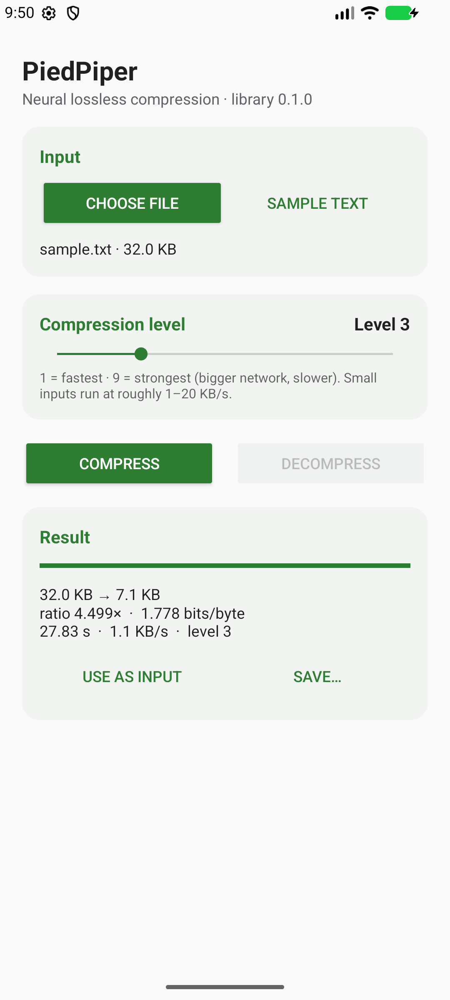

# PiedPiper for Android

Android bindings of [PiedPiper](../../crates/core): neural lossless compression with an
online-learning Transformer driving a range coder (the TufaZip method). Streams are
**bit-identical across platforms**: a file compressed by the desktop CLI decompresses on a phone
and vice versa, and the same input with the same options gives the same bytes everywhere.

| Path | What it is |
| --- | --- |
| [`../../crates/jni`](../../crates/jni) | Rust JNI bindings (`libpiedpiper_jni.so`), exports for `io.piedpiper.PiedPiper` |
| [`piedpiper/`](piedpiper) | Android library (AAR): Kotlin API, packaged `.so` files, instrumented tests |
| [`app/`](app) | Demo app: pick a file (Storage Access Framework) or use the sample text, compress / decompress it on a background thread with progress, cancellation, sizes / ratio / time, and save the result (SAF) |
| [`build-native.sh`](build-native.sh), [`build-native.ps1`](build-native.ps1) | Cross-compile the JNI library for `arm64-v8a`, `armeabi-v7a`, `x86_64` |



## Requirements

* Rust via `rustup` (the scripts add the `aarch64-linux-android`, `armv7-linux-androideabi` and
  `x86_64-linux-android` targets when missing).
* Android SDK with an NDK (tested with NDK r28c `28.2.13676358`) and platform `android-37`.
* JDK 17+ — Android Studio's bundled JBR works:
  `export JAVA_HOME="/c/Program Files/Android/Android Studio/jbr"` (Git Bash) or
  `$env:JAVA_HOME = "C:\Program Files\Android\Android Studio\jbr"` (PowerShell).
* Gradle comes from the wrapper (Gradle 9.8.2, Android Gradle Plugin 9.4.1 with its built-in
  Kotlin). The SDK is found through `ANDROID_HOME` or `local.properties` (`sdk.dir=...`).

## Build

All commands run from `bindings/android`.

**1. Native library** — cross-compiles `crates/jni` in release mode with the NDK's clang
(`<target>24-clang`, matching `minSdk = 24`) and copies the results to
`piedpiper/src/main/jniLibs/<abi>/libpiedpiper_jni.so`:

```sh
./build-native.sh                 # bash: Linux, macOS, Git Bash on Windows
./build-native.sh x86_64          # only some ABIs (arm64-v8a | armeabi-v7a | x86_64)
```
```powershell
.\build-native.ps1                # Windows PowerShell
.\build-native.ps1 -Abi x86_64
```

Cargo writes to `target/android` at the repository root (override with `CARGO_TARGET_DIR`), so it
never contends with desktop builds for the cargo lock. The NDK is taken from `ANDROID_NDK_HOME` /
`ANDROID_NDK_ROOT`, else the newest one under the SDK. Symbols are stripped by default
(`PIEDPIPER_STRIP=0` / `-KeepSymbols` keeps them). The scripts warn if a 64-bit library is not
16 KB page aligned (required on Android 15+ devices with 16 KB pages; NDK r28 aligns by default).

**2. AAR and demo APK:**

```sh
./gradlew :piedpiper:assembleRelease :app:assembleDebug
```

* `piedpiper/build/outputs/aar/piedpiper-release.aar` — the library (Kotlin API + all three ABIs).
* `app/build/outputs/apk/debug/app-debug.apk` — the demo (`adb install -r app/build/outputs/apk/debug/app-debug.apk`).
  It uses only framework widgets (no AndroidX). Its level slider starts at the library default
  (2): levels 1–3 start text from built-in priors, while the bigger networks of 4–9 are slow on
  small inputs and only pay off for large files,
  and "Use as input" feeds a result back in for an in-app roundtrip.

The Gradle build does not run cargo; it fails early with a pointer to `build-native.sh` if no
`.so` is present.

## Using the library

Add the AAR (or include the `:piedpiper` module) to an app. Its only runtime dependency is
`kotlinx-coroutines-core` (for the suspending helpers); R8 keep rules for the JNI entry points
ship inside the AAR (`consumer-rules.pro`).

```kotlin
import io.piedpiper.*

// Blocking calls: run them off the main thread (they are CPU-heavy: roughly 5-50 KB/s).
val packed: ByteArray = PiedPiper.compress(data, CompressOptions(level = 3)) { done, total ->
    // Called on a PiedPiper worker thread after every segment; keep it cheap.
    progressBar.post { progressBar.progress = (done * 100 / total).toInt() }
    !userPressedCancel                       // return false to cancel
}
val original: ByteArray = PiedPiper.decompress(packed)   // CRC-32 verified

// Header without decompressing.
val info: Info = PiedPiper.info(packed)      // originalSize, ratio, tokenizer, model, train, ...

// Coroutines: cancelling the coroutine stops the native codec at its next step.
lifecycleScope.launch {
    val packed = PiedPiper.compressSuspend(data, CompressOptions(level = 2))
    val back = PiedPiper.decompressSuspend(packed)
}
```

Java:

```java
byte[] packed = PiedPiper.compress(data, new CompressOptions(3), (done, total) -> true);
byte[] back = PiedPiper.decompress(packed);
```

### Options

`CompressOptions(level = 2, tokenizer = Tokenizer.Auto, threads = 0, model = null, train = null,
prior = null, allowStored = true, builtinPrior = true)`:

| Option | Meaning | CLI |
| --- | --- | --- |
| `level` | 1 (fastest) .. 9 (largest network); 1–3 use built-in text priors; `PiedPiper.preset(level)` shows the network | `-1` .. `-9` |
| `tokenizer` | `Tokenizer.Auto`, `Tokenizer.Bytes`, `Tokenizer.Bpe(vocab = 4096)` | `-T auto\|bytes\|bpe\|bpe:N` |
| `threads` | worker threads, 0 = all cores; never changes the output | `-t N` |
| `prior` | contents of a pretrained prior (`.ppp`); also needed in `DecompressOptions` | `-p FILE` |
| `builtinPrior` | start text-like input from the level's built-in prior (levels 1–3); streams made with it decode anywhere without extra files | `--no-prior` turns it off |
| `allowStored` | store incompressible input verbatim | (always on) |
| `model = ModelOverrides(dModel, layers, heads, dFf, window, segLen, streams)` | network shape overrides | `--d-model --layers --heads --d-ff --window --seg --streams` |
| `train = TrainOverrides(lr, lrMin, warmup, decay, beta1, beta2, eps, clip, initScale, seed)` | training recipe overrides | `--lr --lr-min --warmup --decay --beta1 --beta2 --clip --init-scale --seed` |

Overrides behave exactly like the CLI flags, so identical flags give identical bytes on every
platform: unset fields keep the level preset's value, a model override pins the whole network
(including `segLen`/`streams`, which otherwise follow the input size), and any override pins the
training recipe. `Info.model.toOverrides()` / `Info.train.toOverrides()` re-create a stream's
exact settings.

### Errors, cancellation, threads

* Failures throw `PiedPiperException` with `kind` = `FORMAT`, `VERSION`, `CHECKSUM`, `OPTIONS`,
  `TOO_LARGE`, `PRIOR` or `INTERNAL` and the native message.
* Cancellation (listener returned `false`, or the coroutine was cancelled) throws
  `PiedPiperCancelledException`, a `java.util.concurrent.CancellationException`.
* An exception thrown by a `ProgressListener` cancels the operation and is re-thrown unchanged.
* The listener runs on PiedPiper's worker threads (they attach to the VM as daemon threads once),
  never on the calling thread. All functions are thread-safe; Rust panics never cross into the
  VM (they surface as `PiedPiperException` of kind `INTERNAL`).
* Inputs and outputs are held in memory (`ByteArray`); a level-6+ network needs tens of MB of
  native memory on top of that.

## Tests

Instrumented tests (`piedpiper/src/androidTest`) need a device or emulator:

```sh
# e.g. a headless emulator
$ANDROID_HOME/emulator/emulator -avd <avd> -no-window -no-audio -no-snapshot-save -gpu swiftshader_indirect &
adb wait-for-device; until [ "$(adb shell getprop sys.boot_completed | tr -d '\r')" = 1 ]; do sleep 2; done

./gradlew :piedpiper:connectedAndroidTest
# report: piedpiper/build/reports/androidTests/connected/debug/index.html
```

* **`GoldenVectorsTest`** — the cross-platform determinism proof. `testdata/golden` (made by the
  desktop CLI on Windows x86_64) is packaged as test assets straight from the repository
  (`assets.srcDir`, nothing is copied). For every vector in `manifest.json`: the files match their
  SHA-256; decompressing `*.bin.pp` reproduces `*.bin` (size, SHA-256, bytes); compressing `*.bin`
  with the manifest's CLI `flags` (parsed into `CompressOptions`) reproduces `*.bin.pp` **byte for
  byte**; the header holds exactly the flag values (floats compared bit for bit).
* **`PiedPiperTest`** — random data roundtrip at level 1 (neural path and stored fallback), text
  roundtrip with progress reporting from a worker thread, cancellation through the listener and
  through coroutine cancellation, listener exceptions re-thrown, corrupt / truncated input,
  invalid options, thread-count independence, presets, BPE, empty input, and re-creating a stream
  from its own header settings.

Recent x86_64 emulator images also run ARM64 code through binary translation
(`ro.product.cpu.abilist` = `x86_64,arm64-v8a`), which exercises the AArch64 library and its
code paths without a device:

```sh
./gradlew :piedpiper:assembleDebugAndroidTest
adb install -r -t --abi arm64-v8a piedpiper/build/outputs/apk/androidTest/debug/piedpiper-debug-androidTest.apk
adb shell am instrument -w -r io.piedpiper.test/androidx.test.runner.AndroidJUnitRunner
adb logcat -d -s PiedPiperGolden     # per-vector timings; "[arm64 on x86_64]" = translated arm64 library
adb uninstall io.piedpiper.test
```

(Under Git Bash, prefix `adb` commands that take device paths with `MSYS_NO_PATHCONV=1`.)

Rust-side unit tests (option mapping, JSON encoding) run on the host:

```sh
CARGO_TARGET_DIR=target/android cargo test -p piedpiper-jni     # from the repository root
```

## Verification status

On the `Medium_Phone` AVD (API 37, x86_64, NDK r28c build, Gradle 9.8.2 / AGP 9.4.1):

* `connectedAndroidTest`: 82/82 tests pass (68 golden + 14 API) with the x86_64 library,
  CheckJNI on (re-run 2026-11-20 after the match-model, filter, deflate, image, audio and
  video work).
* The same 82 pass with the **arm64-v8a** library under ARM64 translation.
* Golden vectors on both ABIs: every `.bin.pp` decompresses to its `.bin`, and re-compression
  reproduces every `.bin.pp` byte for byte — all 17 cases: neural text, BPE and binary with
  explicit networks, the three built-in priors and the prior-rate trial, the x86 branch
  filter, H.264 (CABAC and CAVLC), HEVC, VP9, VP8 and MPEG-2 video, JPEG, raw-image filter and
  WAV audio.
* The demo app (debug and R8-minified release) compresses the sample, decompresses its own
  output, and opens a desktop-made golden stream through the SAF picker; the file it saved through
  the SAF matched the golden SHA-256.

Not verified: `armeabi-v7a` on a device (the scripts build it; no 32-bit ARM emulator image is
available here). On 32-bit ARM the core pins the FPSCR to IEEE defaults (round to nearest, no
flush-to-zero) around every call (`crates/core/src/fpenv.rs`), and its kernels use the scalar
VFP backend because ARMv7 NEON is not IEEE-exact.

## How the JNI layer works

`crates/jni/src/lib.rs` exports `Java_io_piedpiper_PiedPiper_native{Compress,Decompress,Info,Preset,Version,FormatVersion}`.

* Arguments arrive as primitive arrays (inputs copied once into Rust); overrides are passed as
  fixed-layout arrays plus a bit mask of the fields that are set, and mapped onto
  `piedpiper::preset(level)` exactly like the CLI's `build_options`.
* `Info` / presets come back as JSON (parsed with `org.json`); floats are written as the exact
  decimal of their f32 value, so they round-trip bit for bit.
* The progress closure must be `Send`: it holds only a `JavaVM`, a `GlobalRef` to the listener and
  the `onProgress` method id (resolved on the calling thread, since natively attached threads only
  see the system class loader). Each call attaches the worker thread as a daemon if needed and runs
  in its own local-reference frame; a Java exception is captured as a global reference, cleared, and
  re-thrown on the calling thread after the codec returns.
* Every export runs under `catch_unwind`; errors map to `PiedPiperException(message, code)` /
  `PiedPiperCancelledException`.
